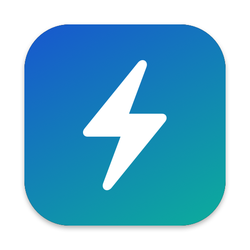

<p align="center"></p>

# PowerBar

A minimal macOS menu bar app that shows how much power your MacBook is drawing, live.

```
 9.6W · 29Wh     ← battery draw · energy left
 +45W · 29Wh     ← charging power on AC
```

Click it for a panel (like Control Center) with:

- **Now** — battery draw in watts, energy left in watt-hours (no percentages), and time left from Wh ÷ your recent average draw. When the Mac is charging a phone or other USB-C device, the draw is split into Mac vs USB-C, with time left if you unplugged it.
- **History** — a chart of battery draw over the last **10 min** or **24 h**, and a **7-day** bar chart of watt-hours used per day (split into Mac vs USB-C devices). Time on power is shaded; your drain-alert threshold is drawn as a dashed line. One-minute averages (including the breakdown) are kept for 30 days in `~/Library/Application Support/PowerBar/history.csv`, and hourly per-app energy in `apps.csv` next to it.
- **Where it's going** and **Apps** follow the chart's range: average watts over the last 10 minutes, or energy used (Wh) over the last 24 hours or 7 days.
- **Where it's going** — the Mac's power split into CPU, GPU, memory, other chip parts (Neural Engine, media engines, display engine), **display & rest** (backlight, SSD, Wi‑Fi, power conversion — whatever's left of the system total), and USB‑C devices
- **Apps** — per-app CPU power and GPU power in watts (each app's share of measured GPU power, by GPU busy time), with helper processes grouped under their app (e.g. all of Firefox's tab processes count as "Firefox")
- **Keeping awake** — apps holding sleep assertions, such as a browser tab's video wake lock, `caffeinate`, or an app holding the audio output open
- **Health** — full-charge capacity vs. new (in Wh), cycle count, temperature

The gear menu has:

- **Low Power Mode** — Never / Only on Battery / Always, same as System Settings (asks for your admin password). The menu bar text turns yellow while it's on.
- **Drain alerts** — an optional notification when draw stays above a threshold (10–30 W, sustained for 2/5/10 min). It ignores power sent to USB-C devices, fires once per episode, re-arms only after draw drops, and never more than once every 30 minutes.
- **Show Wh in Menu Bar**, **Launch at Login**, **Open Activity Monitor**

It runs with no dependencies or root access, and uses ~0% CPU and ~25 MB of RAM.

## Install

Requires an Apple Silicon Mac on macOS 13 or later.

**Homebrew**

```sh
brew install --cask josephvitko/tap/powerbar
```

**Download** — grab `PowerBar-<version>.zip` from [Releases](https://github.com/josephvitko/powerbar/releases), unzip, and move `PowerBar.app` to Applications. Releases are signed and notarized by Apple.

**Build from source** — needs the Xcode Command Line Tools (`xcode-select --install`):

```sh
git clone https://github.com/josephvitko/powerbar.git
cd powerbar
./build.sh   # builds, installs to ~/Applications, and launches
```

Turn on **Launch at Login** from the ⚙ menu to keep it running after restarts. PowerBar checks GitHub once a day for a newer release and shows it in the ⚙ menu.

## How it works

| Reading | Source |
| --- | --- |
| Battery watts | SMC key `PPBR` (updates every few seconds), falling back to `InstantAmperage × Voltage` from `AppleSmartBattery` |
| System watts | SMC key `PSTR` — whole-system power, on battery or AC |
| Chip breakdown | IOReport "Energy Model" channels (`CPU Energy`, `GPU Energy`, `DRAM`/`AMCC`/`DCS`, `ANE`, …) via the private `libIOReport`, the same counters `powermetrics` uses |
| Per-app CPU watts | Δ`ri_energy_nj` from `proc_pid_rusage` (the counters Activity Monitor uses), over a 30 s window |
| Per-app GPU | Δ`accumulatedGPUTime` of each `IOAccelerator` user client, used to split measured GPU power between apps |
| Watt-hours | `AppleRawCurrentCapacity` / `NominalChargeCapacity` (mAh) × present pack voltage |
| USB-C devices | `PowerOutDetails` (per-port milliwatts) on `AppleSmartBattery` |
| Sleep blockers | `IOPMCopyAssertionsByProcess`, attributing audio assertions to the app actually playing |

Caveats:

- Watt-hours use the present pack voltage, so they read a few % high near full and a few % low near empty. They can differ from macOS's percentage, which is smoothed.
- IOReport is a private framework. If a future macOS changes it, the breakdown disappears and everything else keeps working.
- The per-app list won't add up to the total: most of an idle Mac's power is the display and the rest of the system, which no app "owns" — the breakdown bar shows that part. CPU energy for system daemons like WindowServer isn't readable without root; their GPU use does show up.

## Releasing

Push a version tag and the [release workflow](.github/workflows/release.yml) builds, signs, notarizes, publishes the GitHub release, and bumps the Homebrew cask:

```sh
git tag v1.0.0 && git push origin v1.0.0
```

The secrets it needs are listed at the top of the workflow. To release from your own Mac instead, with a Developer ID certificate in your keychain:

```sh
xcrun notarytool store-credentials powerbar   # once
NOTARY_PROFILE=powerbar scripts/release.sh 1.0.0 --publish
```

## License

MIT
